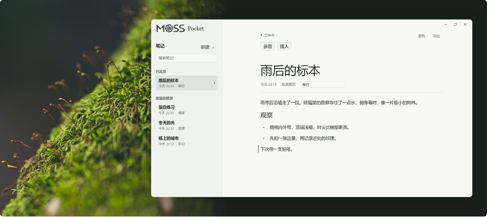
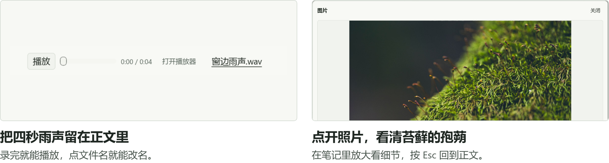

# MOSS Pocket 1.0

**简体中文** · [English](README.en.md)

新建就能写，也可以先录下当时的声音。笔记和附件加密保存在本机。

[下载 Windows x64 便携版](https://github.com/Evergre7n/moss-pocket/releases/download/v1.0.0/MOSS-Pocket-1.0.0-windows-x64.zip) · [发布说明与 SHA-256 校验文件](https://github.com/Evergre7n/moss-pocket/releases/tag/v1.0.0)

<picture>
  <source media="(max-width: 600px) and (prefers-color-scheme: dark)" srcset="docs/screenshots/zh/cover-mobile-dark.webp">
  <source media="(max-width: 600px)" srcset="docs/screenshots/zh/cover-mobile-light.webp">
  <source media="(prefers-color-scheme: dark)" srcset="docs/screenshots/zh/cover-dark.webp">
  
</picture>

<picture>
  <source media="(max-width: 600px) and (prefers-color-scheme: dark)" srcset="docs/screenshots/zh/details-mobile-dark.webp">
  <source media="(max-width: 600px)" srcset="docs/screenshots/zh/details-mobile-light.webp">
  <source media="(prefers-color-scheme: dark)" srcset="docs/screenshots/zh/details-dark.webp">
  
</picture>

解压后双击 `MOSS-Pocket.exe` 即可使用。1.0.0 的 Windows 程序尚未签名。旧版用户请先关闭程序，备份整个 `MOSS-Pocket-data` 文件夹，再把新版 EXE 放回原位置。

## 它是什么

一个记想法的本子。打开就写，停手即存，关窗即锁。

- **轻**：原生程序，界面自己画（Rust + egui），不内嵌浏览器内核。用 OpenGL 渲染，起不来时自动退回 DX12。
- 笔记和附件保存在本机。视频播放器通过本机回环地址按需读取加密附件。
- **锁**：内容用密码派生的密钥加密后才写到磁盘。没有密码，拿到的只是一堆密文。
- **便携**：数据目录跟着 exe 走，整个文件夹拷到 U 盘就能带走。
- **中英双语**：界面跟随系统语言，也可以在设置里切换。

## 功能

**记**

- 一条想法一个条目；左侧列表按修改时间排列，可置顶、加标签。
- 每条笔记由块组成：段落、一到三级标题、项目符号、编号、引用、分割线。
- 文字可以加粗、设为斜体、加下划线或删除线，也可以改颜色。常用组合键见下方快捷键表。
- 撤销和重做贯穿整条笔记，任何操作都能撤回（`Ctrl+Z` `Ctrl+Y`）。
- 新建后光标直接进入正文。标题可留空，也可以用「添加标题」单独补上。

**放**

- **录一条想法**：在正文上方点「录音」，用系统默认麦克风说话，点「完成」后会在笔记里出现可播放的语音条。「取消」会放弃本次录音。
- 单段录到 5 分钟或采样数据达到 32 MiB 时会自动保存。录音时切换笔记、锁定或关窗，已录的内容会保存到开始录音的那篇笔记。
- **插入已有文件**。点正文里希望放置附件的位置，再点「插入」并选「图片」「音频」或「视频」。在笔记窗口里选好文件并确认。新建的空白笔记也可以直接插入。
- 图片支持粘贴截图、粘贴文件和拖入窗口。点「查看图片」可放大阅读；在正文中拖动图片右下角调整排版宽度，双击恢复。
- 录音和音频文件可以在正文直接播放，也可以点「打开播放器」查看进度和定位到某一段。
- 点击语音条末尾的文件名，例如「录音.wav」，输入新名字并按 Enter。扩展名自动保留；按 Esc 可取消。播放器、附件另存为和导出会使用保存后的名字。
- 点「播放视频」在笔记窗口内观看。播放时按需解密，按 Esc 返回正文。
- 视频解码使用 Windows Media Foundation。遇到不支持的编码，播放器会在笔记窗口里提示；可将视频转换为 H.264 编码的 MP4 后插入。
- 整块可以复制、剪切、粘贴（先点选那一块，再按 `Ctrl+C`、`Ctrl+X` 或 `Ctrl+V`）。刚复制过一块时，`Ctrl+V` 粘贴这一块。在别处复制新内容后，粘贴会使用系统剪贴板里的内容。

**找**

- 搜索框查标题、标签和正文全文。
- 在一条笔记里查找和替换：`Ctrl+F` 查找，`Ctrl+H` 带替换。所有命中处高亮，回车跳到下一处。全部替换只占一步撤销。
- 删除的笔记进回收站，保留 30 天。

**带**

- 导出成 Markdown（带媒体文件夹）、网页、Word 文档、PDF。

**调**

设置里可以改主题（深色、浅色、跟随系统）、窗口背景（不透明、纯半透明、磨砂玻璃、云母）、底色和不透明度、强调色、圆角、字号、行距、段间距、语言、闲置自动锁定时间。

## 快捷键

| 按键 | 作用 |
| --- | --- |
| `Ctrl+N` | 新建笔记 |
| `Ctrl+Z` / `Ctrl+Y` | 撤销 / 重做 |
| `Ctrl+B` / `Ctrl+I` / `Ctrl+U` | 加粗 / 斜体 / 下划线 |
| `Ctrl+Shift+X` | 删除线 |
| `Ctrl+F` | 在这条笔记里查找（选中了文字就拿它当查找内容） |
| `Ctrl+H` | 查找并替换 |
| `F3` / `Shift+F3` | 下一处 / 上一处 |
| `Ctrl+L` | 立刻锁定 |
| `Alt+↑` / `Alt+↓` | 整块上移 / 下移 |
| 回车 | 从光标处拆成两块 |
| 行首退格 | 并到上一块 |
| 第一行按上 / 最后一行按下 | 跳到上一块 / 下一块 |

每个块左边的三横线是块菜单：换类型、上下移、复制、插入分割线、插入图片或音视频、删除。

## 第一次使用

1. 双击 `MOSS-Pocket.exe`。
2. 设置密码，用它解锁笔记库。
3. 记下恢复密钥。忘记密码时用它仍能打开，只显示这一次。
4. 开始用。数据存在 exe 旁边的 `MOSS-Pocket-data` 文件夹里。

设置存在 exe 旁边的 `MOSS-Pocket.settings.json`（明文，不含任何机密）。

备份或搬家时，关掉程序，复制整个 `MOSS-Pocket-data` 文件夹。保管好密码和恢复密钥。

## 安全说明

加密方案见 [docs/format.md](docs/format.md)，用的是公开标准：Argon2id 派生密钥，AES-256-GCM 认证加密。

需要知道的三件事：

- **元数据没有加密**：有多少条笔记、每个媒体文件多大、文件的修改时间，这些是看得见的。
- **解锁期间内容在内存里**。离开电脑请锁定（`Ctrl+L`），默认闲置 15 分钟也会自动锁。对这方面要求高的话，请同时使用磁盘加密。
- **弱密码挡不住**。派生函数只能让每次猜测变慢。

## 从源码构建

Windows x64 发布版使用 Rust 的 `x86_64-pc-windows-gnullvm` 工具链、LLVM-MinGW（含资源编译器 `windres`）和 CMake 构建。构建时会把 Opus 解码器静态链接进程序。

```
cargo build --release --locked -p mp-app
```

产物在 `target/release/MOSS-Pocket.exe`。发布包同时附带许可证和第三方组件声明。

制作公开构建时，用 Python 3.11 或更高版本运行 `python tools/build_release.py`。这个入口会将编译机的本地路径映射为通用路径。源码包包含第三方声明的生成工具和归档工具。

PDF 导出使用 Microsoft Edge 的后台打印功能，需要本机已安装 Edge。

运行测试：

```
cargo test --workspace
```

界面测试在内存里驱动实际界面。Windows 发布验收另覆盖设备播放和后台 PDF 导出。在有可用音频输出设备和 Microsoft Edge 的环境中运行完整套件：

```
cargo test --workspace --locked -- --include-ignored --test-threads=1
```

## 目录结构

```
crates/mp-core    核心库：加密、库文件格式、数据模型、编辑逻辑。不依赖任何界面库
crates/mp-app     桌面应用：界面、媒体、导出、设置
docs/format.md    笔记库的文件格式与加密设计
```

## 许可证

MOSS Pocket 的原创软件代码与文档采用 [MIT License](LICENSE)。品牌标识和内嵌字体的声明见[素材说明](docs/ASSET-NOTICES.md)。发布包根目录的 `THIRD-PARTY-NOTICES.md` 可逐项查阅第三方组件及其许可证。
